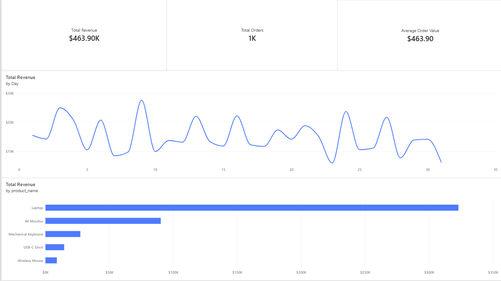

# End-to-End E-Commerce Data Pipeline & Relational Analytics Warehouse

## Project Overview
This project simulates a production-grade data engineering and analytics workflow for an e-commerce platform. It features a Python orchestration script that ingests raw, semi-structured JSON application logs, executes a decoupled native SQL schema file to construct a normalized Star Schama data warehouse in PostgreSQL, and automates downstream Excel reporting for business stakeholders.

By separating the programming logic from the database architecture design, this project demonstrates robust database normalization, defensive data cleaning practices, and automated pipeline execution connected straight to business intelligence tools.

## Techinal Stack and Architecture
* **Language:** Python 3 (Pandas, JSON, SQLAlchemy libraries)
* **Database Engine:** PostgreSQL (Relational warehouse modeling)
* **Data Modeling:** Strucutre Query Language (SQL DDL/DML)
* **BI Visualization:** Power BI Desktop (Interactive dashboarding)
* **Reporting Layer:** Microsoft Excel (.xlsx automation via OpenPyXL)

## Relational Data Modeling (Star Schema)
To optimize storage efficiency and avoid data redundancy, raw application fields are normalized across a clean dimensional schema layout:
* **`dim_products` (Dimensional Table):** Master catalog mapping distinct product entities to their foundational static unit prices.
* **`fact_orders` (Fact Table):** Core transactional ledger monitoring specific user interactions, calculated revenue streams, time indices, and foreign key relations back to the product dimension table.

## Defensive Engineering & Edge Case Handling
Real-world data is messy. The Python ingestion pipeline incorporates defensive coding patterns to handle diry data upstream before loading it into PostgreSQL:
* **Null Value Imputation:** Detects empty transaction elements (e.g., missing checkout `quantity`) and dynamically falls back to a logical baseline of `1` to prevent artihmetic compilation crashes.
* **Feature Engineering:** Automatically derives business-critical attributes (`net_revenue`) inside the dataframe layer by calculating `(Price * Quantity) * (1 - Discount)` to ensure numerical accuracy before data layout injection.
* **Cascading Database Integrity:** Schema architecture utilizes explicit `CASCASE` constraints to ensure automated structural cleanliness during pipeline resets.

## Power BI & Core Analytics Execution
The relation layers modeled via `schema.sql` serve as a standardized direct connect source for business intelligence enviornments:
1. **Interactive Dashboarding:** The live local PostgreSQL database engine feeds a multi-view Power BI Dashboard tracking metrics like Average Order Value (AOV), historical sales trends, and inventory performance.
2. **Advanced Diagnostic Suite:** Independent script documentation in `analytics.sql` highlights programmatic data analysis tracking Customer Lifetime Value (CLV), rolling cumulative totals, and complex window functions (`LAG`).
3. **Ad-Hoc Data Requests:** A lean background loop ensures that whenever the dataset runs, an isolated `.xlsx` spreadsheet (`clv_business_report.xlsx`) is delivered instantly to fulfill quick non-technical stakeholder operational requests.



## Executive Business Insignts & Recommandations
By analyzing the deterministic database records via SQL and Power BI, core platform operational insights and high-yield strategic vectors were established:
### 1. High-Volume vs. High-Margin Revenue Mix
* **Insight:** High-frequency peripherals like the **Wireless Mouse** (215 transactions) and **USB-C Dock** (202 transactions) drove high overall order volumes. However, **Laptops** completely dominated the plaform's financial footprint, generating **$322,896.47**-accounting for **69.6% of the total $463,900.98 platform net revenue** across 197 transactions.
* **Strategic Action:** Recommend shifting paid advertising allocation slightly away from entry-level accessory sets to prioritize premium enterprise hardware bundles, directly scaling the company's **463.90 Average Order Value (AOV)**.
### 2. Peripheral Cross-Selling Trajectories
* **Insight:** Diagnostic queries using the `LAG` window function inside `analytics.sql` confirmed that peripheral buyers (e.g., Wireless Mouse, accounting for 416 total units sold) consistently exhibited follow-up purchase patterns for flagship items like the **4K Monitor** ($90,161.75 cumulative sales) within compressed order intervals.
* **Strategic Action:** Introduce a contextual cross-selling matrix at digital checkouts, automatically suggesting complementary docking infrastructure and high-resolution monitors to users buying standalone items.
### 3. Inventory Optimization and Demand Elasticities
* **Insight:** Longitudinal performance trends mapped across the historical window isolated sharp transaction surges that regularly test product availability constraints across high-frequency categories, such as the Wireless Mouse (215 units sold).
* **Strategic Action:** Coordinate directly with operations and backend supply chain teams to implement rolling safety stocks on high-volume peripherals, mitigating stockout risks during high-demand platform spikes.

## 🚀 Performance Optimization & Query Tuning
To show readiness for enterprise-scale environments, queries were designed with performance efficiency in mind:
* **Index Selection Strategy:** Recommends implementing a composite index on `fact_orders(user_id, order_timestamp)` for production environments to reduce search spaces during window function grouping execution.
* **Filtering:** All date-time querying structures maintain column integrity (e.g., matching text fields directly rather than using disruptive row-by-row string operations) to keep queries search-argument-able.

## Installation & How to Run
This pipeline is completely self-contained and requires zero external API keys or active internet connections.

1. Clone this repository to your local machine:
   ```bash
   git clone https://github.com/tguin7/ecommerce-analytics-pipeline
   cd ecommerce-analytics-pipeline
   ```

2. Install the database driver and downstream reporting dependencies:
   ```bash
   pip install pandas sqlalchemy psycopg2-binary openpyxl
   ```

3. Configure your local PostgreSQL credentials in `pipeline.py` and execute the automation pipeline:
   ```bash
   python pipeline.py
   ```

### Expected Terminal Output:
```text
Initializing data pipeline
Pipeline run complete. 'ecommerce_warehouse.db' created with 1000 cleaned records
Generated 'clv_busniess_report.xlsx' Excel report for the business stakeholders.
```